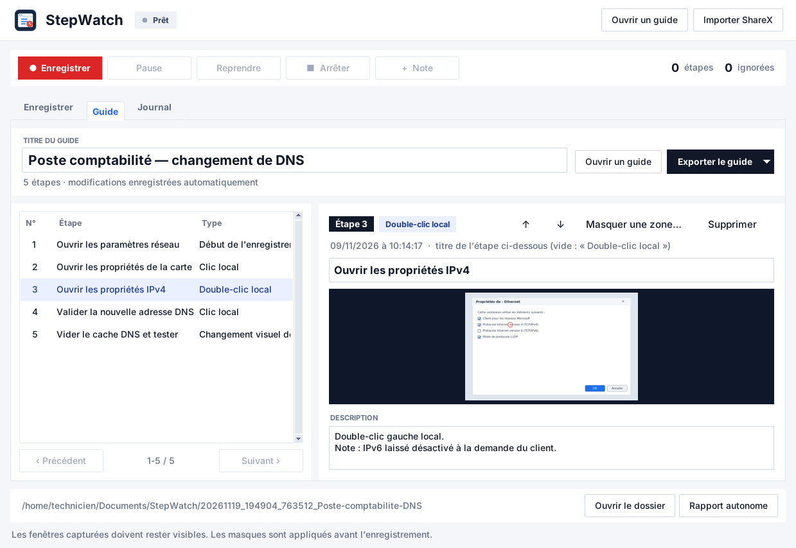
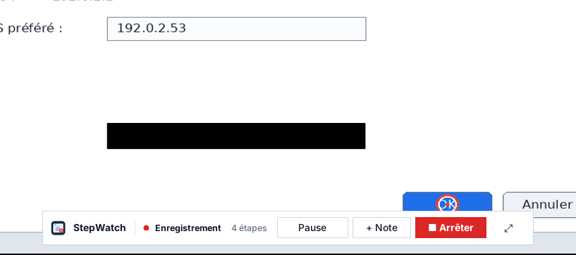
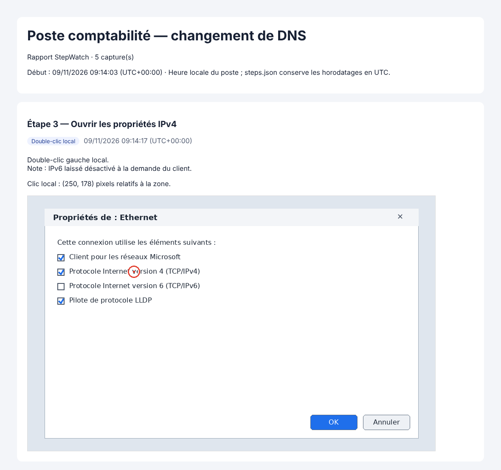

# StepWatch

*[Version française](README.md)*

StepWatch documents IT support sessions with automatic screenshots, notes and an offline report. It runs on the technician's workstation during local and remote support.

While recording, StepWatch shrinks into a small floating bar. Afterwards, the **Guide** tab is an editor: step titles and descriptions, order, removal, blacking out a forgotten area, then standalone HTML or Markdown export. Screenshots and reports stay on the workstation.

The application interface and the documentation in `docs/` are in French.

[Download the latest version](https://github.com/1002-AZ-2001/StepWatch/releases/latest) · [Record a support session](#record-a-support-session)

| System | Capture |
| --- | --- |
| Windows 10/11 | Local clicks and visual changes for a window, monitor or region. |
| Linux X11 | Local clicks and visual changes for a visible window, monitor or region. |
| Linux Wayland | Visual changes from the screen or window shared through the desktop portal. The app window uses XWayland. [Wayland setup in French](docs/distribution.md#wayland) |



## Download

The latest release includes Windows executables, Linux packages and their checksums. [GitHub Releases](https://github.com/1002-AZ-2001/StepWatch/releases)

| File | For |
| --- | --- |
| `StepWatch-VERSION-windows-x64.exe` | Windows 10/11 x64, single file. |
| `StepWatch-VERSION-windows-x64-portable.zip` | Windows x64, extract the entire portable folder. |
| `stepwatch_VERSION_amd64.deb` | Debian 12+ and Ubuntu 22.04+. |
| `stepwatch-VERSION-1-x86_64.pkg.tar.zst` | Arch Linux. |
| `SHA256SUMS-*.txt` | Download verification. |

Python is bundled. The Windows executables are not signed yet, so SmartScreen may show a warning: check the SHA-256 first. Installation, verification and building from source are described in the [distribution guide](docs/distribution.md) (French).

```bash
# Debian or Ubuntu, after downloading the .deb
sudo apt install ./stepwatch_VERSION_amd64.deb
# Arch Linux, after downloading the package
sudo pacman -U ./stepwatch-VERSION-1-x86_64.pkg.tar.zst
# Launch, or check the installation without personal data
stepwatch
stepwatch --self-test
```

### From source, on Windows

You need Windows 10/11 and Python 3.11 or later (3.12 recommended), installed with Tcl/Tk and pip. From the repository folder, in PowerShell:

```powershell
.\scripts\install.ps1
.\scripts\launch.ps1
```

`install.ps1` looks for Python 3.12, 3.13, then 3.11 with the `py` launcher, checks Tcl/Tk, then creates `.venv` with the versions in `requirements.txt`. To force an interpreter: `.\scripts\install.ps1 -Python "C:\Python312\python.exe"`. No script changes the PowerShell execution policy. If the policy blocks scripts, run directly:

```powershell
py -3.12 -m venv .venv
.\.venv\Scripts\python.exe -m pip install -r requirements.txt
.\.venv\Scripts\python.exe -m stepwatch
```

### From source, on Linux

Use Python 3.11 or later with venv and Tkinter. For Wayland recording, also install the desktop capture dependencies. [Linux distribution guide in French](docs/distribution.md#linux--debian-ubuntu-et-arch-linux)

```bash
python3 -m venv .venv
.venv/bin/python -m pip install -r requirements.txt
.venv/bin/python -m stepwatch
```

## Record a support session

1. In the **Enregistrer** (Record) tab, enter the guide name and choose its folder.
2. On Windows and X11, select a window, monitor or region. **Actualiser** (Refresh) reloads the list. Coordinates are physical pixels. A monitor on the left can have a negative origin.
3. Choose **Hybride** (local clicks and visual changes), clicks only, or visual changes only. Wayland sessions use visual changes mode.
4. If needed, open **Réglages avancés** (Advanced settings): comparison interval, threshold, click delay, conservative mode, and masks as `x,y,width,height` (one per line, relative to the top-left corner). A lower threshold keeps more steps.
5. Click **● Enregistrer** (Record). On Wayland, choose a source in the desktop picker and allow sharing.
6. The main window gives way to a **floating bar** at the bottom of the screen: status, step count, **Pause**/**Reprendre** (Resume), **+ Note**, **■ Arrêter** (Stop), and **⤢** to reopen the window. Drag it to move it. Its clicks never become steps. On Windows 10 (version 2004 and later) and 11, it is excluded from captures; elsewhere, the part over the target is blacked out in captures. Untick **Barre flottante pendant l'enregistrement** to keep the main window.
7. **+ Note** attaches free text to the latest step, while recording or paused.
8. After stopping, the window comes back on the **Guide** tab to review and edit the steps (see below). The **Journal** tab shows events and errors.



## Edit the guide

The **Guide** tab opens the session just recorded, or another folder with **Ouvrir un guide** (Open a guide). Every change is saved at once to `steps.json`, `rapport.html` and `rapport.md`.

- **Guide title**: editable at the top of the tab.
- **Step title**: by default, the step type ("Clic local", "Double-clic local"…). A typed title replaces it in reports; the type stays visible as a chip.
- **Description**: the step text, notes included.
- **↑ ↓**: reorder; steps are renumbered.
- **Supprimer** (Remove): removes the step from reports. Its screenshot moves to `captures/retirees/`, without being destroyed; delete that folder to erase it.
- **Masquer une zone…** (Black out an area): draw over forgotten data with the mouse. This is permanent: the original pixels are not kept.
- **Exporter le guide** (Export): standalone report (one HTML file), Markdown, or open the folder.

After a change, an existing standalone report holds the previous version, possibly with the removed step or the unmasked area: StepWatch deletes it and says so in the log. Export it again before sharing.

The recorder groups rapid presses into a single local double-click step. A second press received after the first screenshot can produce another step. For AnyDesk, TeamViewer or RDP, select the local window of the remote support software. Actions by the remote client can produce visual change steps. Markers show local clicks.

## Screenshots and reports



Each session has its own folder:

| File | Content |
| --- | --- |
| `captures/*.png` | Masked screenshots, with a red marker on local clicks. |
| `steps.json` | Steps, UTC timestamps, triggers, click coordinates, annotations and notes. |
| `rapport.html` | Offline report, in the workstation's local time. It prints to PDF from the browser without splitting steps. |
| `rapport.md` | The same report in Markdown, for a wiki or a ticket, with the same links to `captures/`. |
| `rapport-autonome.html` | Created by **Rapport autonome**: one file with embedded screenshots (about 33 % larger). |

**Importer ShareX** (Import ShareX) copies the images of a folder into a new session and opens the **Guide** tab. It sorts the files by modification date and name, and leaves the original images in place. Masks apply to recordings only.

Screenshots may contain confidential data. Choose a suitable folder and manage its protection and retention. A synchronised folder (OneDrive, a share backed up to the cloud…) would send the screenshots off the workstation. Masks stay fixed relative to the capture and do not detect passwords: do not display sensitive data outside masked areas.

If an antivirus or a sync tool briefly locks a file, the write is retried. If the report stays locked, the PNG is kept and recording continues; the report is rewritten at the next capture and when recording stops.

## Capture limitations

- On Windows and X11, keep the target window unobstructed. An overlapping window can appear in the capture.
- Clicks on StepWatch (floating bar or main window) are ignored. If the main window stays visible over the target, it is blacked out in captures; prefer the floating bar. On Wayland, StepWatch does not know where the shared source is and cannot mask its own window: keep it outside the shared area.
- A click belongs to the target only if it lands on it or on a dialog it owns.
- A closed, minimised or hidden window produces an explicit error in the log.
- On Windows, the UAC secure desktop, protected content and elevated windows can prevent capture or click reception.
- Windows can silently remove a slow low-level mouse hook. StepWatch detects this through the physical button state, reinstalls the hook and reports it ("des clics ont pu manquer", clicks may have been missed): check the latest steps.
- The visual comparison ignores small variations, without a guarantee for every animation. A change shorter than the interval can go unnoticed.

## Menus and settings

The menu bar offers **Fichier** (File: open, recent guides, ShareX import, exports, **Paramètres…** settings, quit), **Enregistrement** (Recording: start Ctrl+R, pause, note, stop, refresh targets F5), **Guide** (undo, title, move, black out, remove), **Affichage** (View: tabs Ctrl+1/2/3, advanced settings) and **Aide** (Help: shortcuts F1, online documentation, report a problem, log and settings folders, installation check, **check for updates**, about). Unavailable entries are greyed out.

**Paramètres…** (Ctrl+,) sets: the suggested guide name with `{date}` and `{heure}` (time) placeholders, the guides folder, the floating bar and its position (bottom or top), Windows global shortcuts, a sound on each step, opening the Guide tab after stopping, an automatic standalone report after stopping, delete confirmation, keeping or erasing the screenshot of a removed step (erasing cannot be undone and is always confirmed), text size (next launch) and advanced settings shown at startup. **Réinitialiser** (Reset) restores the defaults and keeps recent guides.

## Automatic updates

At startup, at most once a day, StepWatch asks GitHub for the latest published version. If it is newer, a window shows its notes with **Installer et redémarrer** (install and restart), **Plus tard** (later), **Ignorer cette version** (skip) and **Voir sur GitHub**. **Aide › Rechercher des mises à jour…** checks on demand. A version found while recording is offered after the stop.

- Windows `.exe`: the file is replaced in place; the old copy is deleted at the next start.
- Windows portable folder: files are copied by a PowerShell script once StepWatch has closed, then it restarts.
- Debian/Ubuntu and Arch Linux packages: `pkexec apt-get install` or `pkexec pacman -U` (administrator password).
- From source: the window opens the release page.

The download must match two SHA-256 checksums before anything is installed: GitHub's digest of the asset and the release's `SHA256SUMS` file. They detect corrupted or altered downloads, not a release published by someone who took over the repository: files are not signed yet. This is StepWatch's only network access, a request to GitHub's public releases API (GitHub sees the workstation's IP address); no screenshot, log or identifier is sent. Turn it off in **Paramètres › Général**.

## Keyboard shortcuts, preferences

| Shortcut | Action |
| --- | --- |
| Ctrl+Shift+F9 / F10 / F11 | Pause or resume / add a note / stop recording |
| Delete, Ctrl+↑/↓, Ctrl+Z, F2 | Guide tab: remove, move, undo, edit the step title |

On Windows, the three recording shortcuts work in every application: StepWatch reserves them with `RegisterHotKey`, which reports only those combinations; no other keystroke is observed. On Linux, they work while a StepWatch window has focus. **↶ Annuler** (Ctrl+Z) undoes title, description, name, order and removal changes (masking is permanent). **Ouvrir un guide ▾** lists recent guides.

StepWatch remembers the guides folder, target, mode, advanced settings, masks, floating bar, window size and recent guides in a local `settings.json` (`%APPDATA%\StepWatch` on Windows, `~/.config/stepwatch` on Linux). Only one StepWatch window can be open at a time.

## Diagnostic log

The local log `%LOCALAPPDATA%\StepWatch\logs\stepwatch.log` (`~/.local/state/stepwatch/` on Linux) rotates over at most 4 files of 1 MB. `crash.log` collects native crashes. These files contain no image or keystroke, but may contain session names, window titles and paths: review them before sharing.

## Development and next steps

- [Architecture](docs/architecture.md): modules, threads and guarantees.
- [Validation](docs/validation.md): automated tests, CI, real Windows checklist and measurements.
- A new version on `main` triggers package builds and publication after the tests pass. [Release guide in French](docs/distribution.md#publier-une-nouvelle-version)
- [Roadmap](docs/FEUILLE_DE_ROUTE.md): recent releases, report editing, capture reliability and distribution.
- [Changelog](CHANGELOG.md) and [project history](docs/HISTORIQUE.md).

```bash
.venv/bin/python -m pip install -r requirements-dev.txt
.venv/bin/ruff check stepwatch tests scripts
DISPLAY=:99 STEPWATCH_GUI_TESTS=1 .venv/bin/python -m unittest discover -s tests -v
```

The images in this README show a demonstration session and report with synthetic data, on Linux. The floating bar, the guide editor and the split between recording and review are inspired by [OpenSteps](https://github.com/ebanez8/openstep) (MIT licence); no code is reused from it.

Thanks to DokT for the first English translation.

License: [GNU AGPL v3](LICENSE).

References: [Steps Recorder deprecation](https://www.neowin.net/news/microsoft-deprecates-even-more-windows-features-steps-recorder-gets-the-axe/), [low-level mouse hooks](https://learn.microsoft.com/windows/win32/winmsg/lowlevelmouseproc), [mss](https://python-mss.readthedocs.io/), [pynput](https://pynput.readthedocs.io/), [Pillow](https://pillow.readthedocs.io/).
