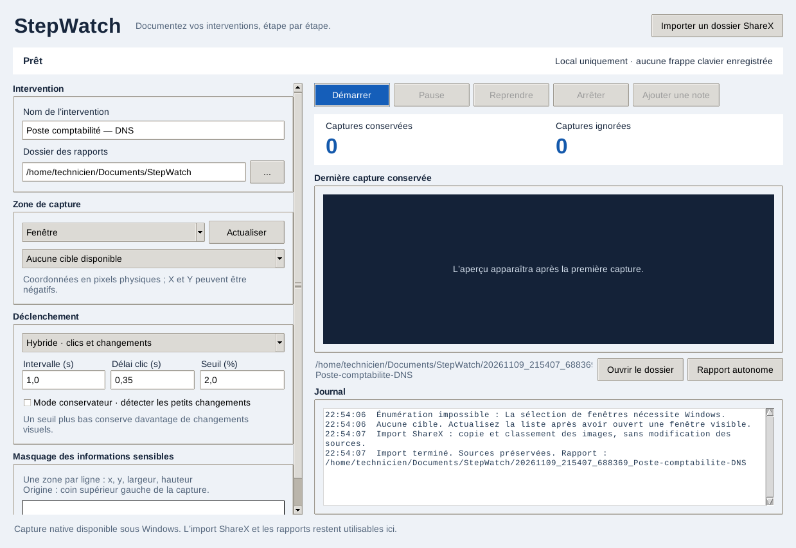
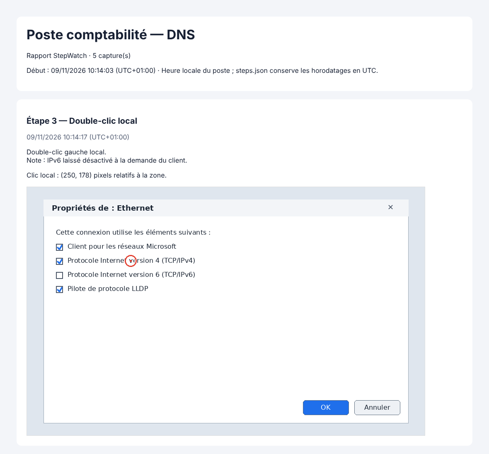

# StepWatch

*[Version française](README.md)*

StepWatch documents an IT support session step by step, using the pixels visible on the technician's Windows workstation. Each local click or visual change becomes an annotated screenshot, and the HTML report can be read offline. Screenshots and reports remain on the workstation: no agent is installed on the client's computer, and nothing is sent over the Internet.

Version **0.4** uses Python, Tkinter, Pillow, `mss` and `pynput`. No keystroke is recorded, and sensitive areas can be masked before images are written. Microsoft has deprecated the Windows Steps Recorder (`psr.exe`); StepWatch is a local alternative designed for remote support.

The application interface and the documentation in `docs/` are in French.



## Download

Executables are published in the [Releases](https://github.com/1002-AZ-2001/StepWatch/releases). The [latest release](https://github.com/1002-AZ-2001/StepWatch/releases/latest) provides:

| File | For |
| --- | --- |
| `StepWatch-VERSION-windows-x64.exe` | Windows 10/11: a single file, no installation. |
| `StepWatch-VERSION-windows-x64-portable.zip` | Windows: portable folder, extract it entirely. |
| `stepwatch_VERSION_amd64.deb` | Debian 12+ and Ubuntu 22.04+: ShareX import and reports only. |
| `stepwatch-VERSION-1-x86_64.pkg.tar.zst` | Arch Linux: ShareX import and reports only. |
| `SHA256SUMS-*.txt` | Download verification. |

Python is bundled. The Windows executables are not signed yet, so SmartScreen may show a warning: check the SHA-256 first. Installation, verification and building from source are described in the [distribution guide](docs/distribution.md) (French).

```bash
# Debian or Ubuntu, after downloading the .deb
sudo apt install ./stepwatch_VERSION_amd64.deb
# Arch Linux, after downloading the package
sudo pacman -U ./stepwatch-VERSION-1-x86_64.pkg.tar.zst
# Launch, or check the installation without personal data
stepwatch
stepwatch --self-test
```

**Recording requires Windows.** On Linux, the interface only offers the ShareX import and the reports, in X11 and **Wayland** sessions alike. On Wayland, StepWatch is displayed through XWayland, available by default on most desktops: see the [distribution guide](docs/distribution.md#wayland) (French).

### From source, on Windows

You need Windows 10/11 and Python 3.11 or later (3.12 recommended), installed with Tcl/Tk and pip. From the repository folder, in PowerShell:

```powershell
.\scripts\install.ps1
.\scripts\launch.ps1
```

`install.ps1` looks for Python 3.12, 3.13, then 3.11 with the `py` launcher, checks Tcl/Tk, then creates `.venv` with the versions in `requirements.txt`. To force an interpreter: `.\scripts\install.ps1 -Python "C:\Python312\python.exe"`. No script changes the PowerShell execution policy. If the policy blocks scripts, run directly:

```powershell
py -3.12 -m venv .venv
.\.venv\Scripts\python.exe -m pip install -r requirements.txt
.\.venv\Scripts\python.exe -m stepwatch
```

## Record a support session

1. Enter a name and choose the reports folder.
2. Select a window, a monitor or a region. **Actualiser** (Refresh) reloads the list. Coordinates are physical pixels; a monitor placed on the left can have a negative origin.
3. Choose a mode: **Hybride** (local clicks and visual changes), clicks only, or visual changes only.
4. Set the delay after a click, the comparison interval and the threshold. The threshold is a proportion of changed pixels: the lower it is, the more steps StepWatch keeps. Conservative mode detects small changes.
5. Add masks if needed, one per line: `x,y,width,height`, relative to the top-left corner of the capture. Click **Démarrer** (Start); nothing is captured before that.
6. Use **Pause**, **Reprendre** (Resume) and **Arrêter** (Stop). The preview, counters and log show kept screenshots, ignored comparisons and errors.
7. **Ajouter une note** (Add a note) attaches free text to the latest step, while recording or paused.
8. After stopping, **Ouvrir le dossier** (Open folder) shows the session, and **Rapport autonome** (Standalone report) produces a single HTML file to attach to a ticket.

A double-click or triple-click becomes a single "local double-click" step, captured after the last press. For AnyDesk, TeamViewer or RDP, select the local window of the remote support software. An action by the remote client becomes a "visual change detected": StepWatch cannot know where that click happened, and markers only show local clicks.

## Screenshots and reports



Each session has its own folder:

| File | Content |
| --- | --- |
| `captures/*.png` | Masked screenshots, with a red marker on local clicks. |
| `steps.json` | Steps, UTC timestamps, triggers, click coordinates, annotations and notes. |
| `rapport.html` | Offline report, in the workstation's local time. It prints to PDF from the browser without splitting steps. |
| `rapport.md` | The same report in Markdown, for a wiki or a ticket, with the same links to `captures/`. |
| `rapport-autonome.html` | Created by **Rapport autonome**: one file with embedded screenshots (about 33 % larger). |

**Importer un dossier ShareX** (Import a ShareX folder) copies the images of a folder, without its subfolders, into a new session. They are sorted by modification date, then by name. Source files are never modified. Masks do not apply to imports.

Screenshots may contain confidential data. Choose a suitable folder and manage its protection and retention. A synchronised folder (OneDrive, a share backed up to the cloud…) would send the screenshots off the workstation. Masks stay fixed relative to the capture and do not detect passwords: do not display sensitive data outside masked areas.

If an antivirus or a sync tool briefly locks a file, the write is retried. If the report stays locked, the PNG is kept and recording continues; the report is rewritten at the next capture and when recording stops.

## Windows capture limitations

- The capture uses the pixels of the visible desktop: keep the target window unobstructed, or an overlapping window will appear in the image.
- A click belongs to the target only if it lands on it or on a dialog it owns.
- A closed, minimised or hidden window produces an explicit error in the log.
- The UAC secure desktop, protected content and elevated windows can prevent capture or click reception.
- Windows can silently remove a slow low-level mouse hook. StepWatch detects this through the physical button state, reinstalls the hook and reports it ("des clics ont pu manquer", clicks may have been missed): check the latest steps.
- The visual comparison ignores small variations, without a guarantee for every animation. A change shorter than the interval can go unnoticed.

## Diagnostic log

The local log `%LOCALAPPDATA%\StepWatch\logs\stepwatch.log` (`~/.local/state/stepwatch/` on Linux) rotates over at most 4 files of 1 MB. `crash.log` collects native crashes. These files contain no image or keystroke, but may contain session names, window titles and paths: review them before sharing.

## Development and next steps

- [Architecture](docs/architecture.md): modules, threads and guarantees.
- [Validation](docs/validation.md): automated tests, CI, real Windows checklist and measurements.
- [Distribution](docs/distribution.md): building executables and publishing a new version (one release per version).
- [Roadmap](docs/FEUILLE_DE_ROUTE.md): versions 0.5 (shareable reports), 0.6 (more reliable capture) and 1.0 (distribution), and Linux recording under study.
- [Changelog](CHANGELOG.md) and [project history](docs/HISTORIQUE.md).

```bash
.venv/bin/python -m pip install -r requirements-dev.txt
.venv/bin/ruff check stepwatch tests scripts
DISPLAY=:99 STEPWATCH_GUI_TESTS=1 .venv/bin/python -m unittest discover -s tests -v
```

The images in this README come from a real run on Linux with synthetic screenshots: the interface after a ShareX import, and a report produced by StepWatch's storage code.

Thanks to DokT for the first English translation.

License: [GNU AGPL v3](LICENSE).

References: [Steps Recorder deprecation](https://www.neowin.net/news/microsoft-deprecates-even-more-windows-features-steps-recorder-gets-the-axe/), [low-level mouse hooks](https://learn.microsoft.com/windows/win32/winmsg/lowlevelmouseproc), [mss](https://python-mss.readthedocs.io/), [pynput](https://pynput.readthedocs.io/), [Pillow](https://pillow.readthedocs.io/).
