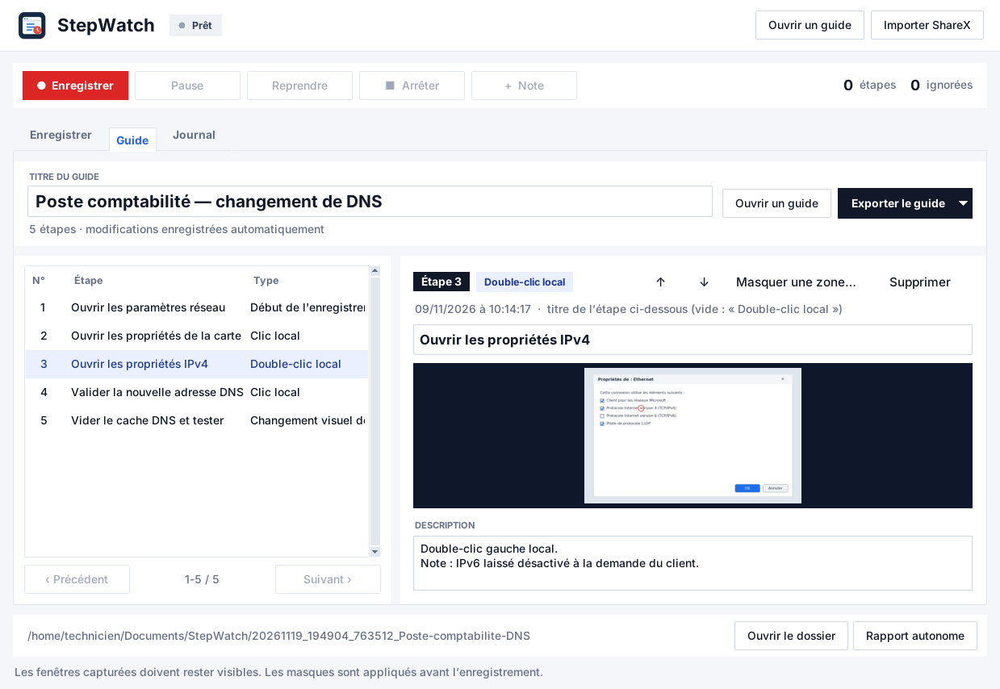
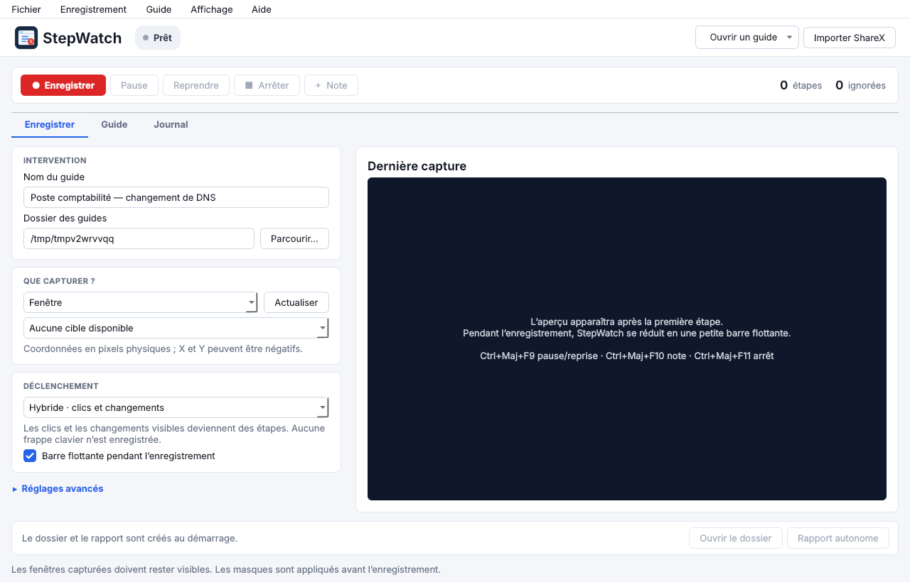
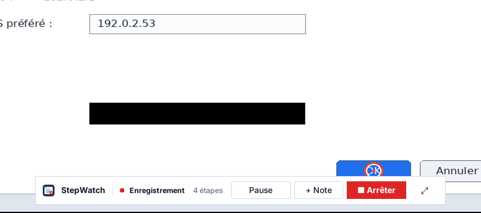
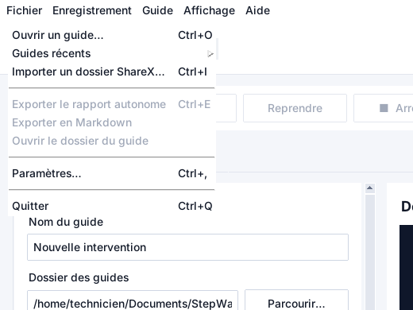
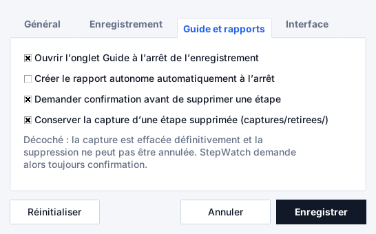
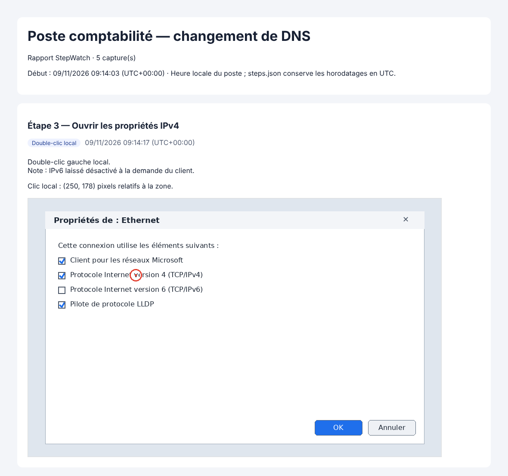

# StepWatch

*[English version](README.en.md)*

StepWatch documente une intervention informatique avec des captures automatiques, des notes et un rapport consultable hors ligne. Il s'installe sur le poste du technicien pour suivre une intervention locale ou une session de télémaintenance.

Pendant l'enregistrement, StepWatch se réduit en une petite barre flottante. Ensuite, l'onglet **Guide** sert d'éditeur : titres et descriptions des étapes, ordre, suppression, masquage d'une zone oubliée, puis export HTML autonome ou Markdown. Les captures et les rapports restent sur le poste.

[Télécharger la dernière version](https://github.com/1002-AZ-2001/StepWatch/releases/latest) · [Enregistrer une intervention](#enregistrer-une-intervention)

| Système | Capture |
| --- | --- |
| Windows 10/11 | Clics locaux et changements visuels d'une fenêtre, d'un moniteur ou d'une zone. |
| Linux X11 | Clics locaux et changements visuels d'une fenêtre visible, d'un moniteur ou d'une zone. |
| Linux Wayland | Changements visuels de l'écran ou de la fenêtre partagée dans le portail du bureau. L'interface s'affiche via XWayland. [Composants Wayland](docs/distribution.md#wayland) |



## Télécharger

La dernière Release fournit les exécutables Windows, les paquets Linux et leurs sommes de contrôle. [Releases GitHub](https://github.com/1002-AZ-2001/StepWatch/releases)

| Fichier | Pour |
| --- | --- |
| `StepWatch-VERSION-windows-x64.exe` | Windows 10/11 x64, exécutable sans installation. |
| `StepWatch-VERSION-windows-x64-portable.zip` | Windows x64, dossier portable à extraire en entier. |
| `stepwatch_VERSION_amd64.deb` | Debian 12+ et Ubuntu 22.04+. |
| `stepwatch-VERSION-1-x86_64.pkg.tar.zst` | Arch Linux. |
| `SHA256SUMS-*.txt` | Vérification des téléchargements. |

Python est inclus. Les exécutables Windows ne sont pas encore signés : SmartScreen peut afficher un avertissement, donc vérifiez d'abord le SHA-256. Les commandes d'installation et de vérification, ainsi que la construction depuis les sources, sont dans le [guide de distribution](docs/distribution.md).

```bash
# Debian ou Ubuntu, après téléchargement du .deb
sudo apt install ./stepwatch_VERSION_amd64.deb
# Arch Linux, après téléchargement du paquet
sudo pacman -U ./stepwatch-VERSION-1-x86_64.pkg.tar.zst
# Lancer, ou vérifier l'installation sans données personnelles
stepwatch
stepwatch --self-test
```

### Depuis les sources, sous Windows

Il faut Windows 10/11 et Python 3.11 ou ultérieur (3.12 recommandé), installé avec Tcl/Tk et pip. Depuis le dossier du dépôt, dans PowerShell :

```powershell
.\scripts\install.ps1
.\scripts\launch.ps1
```

`install.ps1` cherche Python 3.12, 3.13 puis 3.11 avec le lanceur `py`, vérifie Tcl/Tk, puis crée `.venv` avec les versions de `requirements.txt`. Pour forcer un interpréteur : `.\scripts\install.ps1 -Python "C:\Python312\python.exe"`. Aucun script ne modifie la politique d'exécution PowerShell. Si elle bloque les scripts, utilisez directement :

```powershell
py -3.12 -m venv .venv
.\.venv\Scripts\python.exe -m pip install -r requirements.txt
.\.venv\Scripts\python.exe -m stepwatch
```

### Depuis les sources, sous Linux

Utilisez Python 3.11 ou ultérieur avec venv et Tkinter. En session Wayland, installez aussi les composants de capture du bureau. [Guide de distribution Linux](docs/distribution.md#linux--debian-ubuntu-et-arch-linux)

```bash
python3 -m venv .venv
.venv/bin/python -m pip install -r requirements.txt
.venv/bin/python -m stepwatch
```

## Enregistrer une intervention



1. Dans l'onglet **Enregistrer**, saisissez le nom du guide et choisissez son dossier.
2. Sous Windows et X11, sélectionnez une fenêtre, un moniteur ou une zone. **Actualiser** recharge la liste. Les coordonnées sont en pixels physiques et l'origine d'un écran placé à gauche peut être négative.
3. Choisissez le mode **Hybride** (clics locaux et changements visuels), **Clics uniquement** ou **Changements visuels uniquement**. En session Wayland, le mode changements visuels est sélectionné.
4. Si besoin, ouvrez **Réglages avancés** : intervalle de comparaison, seuil, délai après clic, mode conservateur, et masques au format `x,y,largeur,hauteur` (un par ligne, relatif au coin supérieur gauche de la capture). Plus le seuil est bas, plus StepWatch garde d'étapes.
5. Cliquez sur **● Enregistrer**. Sous Wayland, choisissez la source dans le sélecteur du bureau et autorisez le partage.
6. La fenêtre principale laisse la place à une **barre flottante** en bas de l'écran : état, nombre d'étapes, **Pause**/**Reprendre**, **+ Note**, **■ Arrêter**, et **⤢** pour rouvrir la fenêtre. Déplacez-la en la faisant glisser. Ses clics ne deviennent jamais des étapes. Sous Windows 10 (version 2004 et ultérieures) et 11, elle est exclue des captures ; ailleurs, la partie qui recouvre la cible est noircie dans les captures. Décochez **Barre flottante pendant l'enregistrement** pour garder la fenêtre principale.
7. **+ Note** attache un texte libre à la dernière étape, pendant l'enregistrement ou la pause.
8. Après l'arrêt, la fenêtre revient sur l'onglet **Guide** pour relire et modifier les étapes (voir ci-dessous). L'onglet **Journal** affiche les événements et les erreurs.



Le moteur regroupe les appuis rapprochés en une étape « Double-clic local ». Un second appui reçu après la capture de la première étape peut produire une autre étape. Pour AnyDesk, TeamViewer ou RDP, sélectionnez la fenêtre locale du logiciel de télémaintenance. Une action du client distant peut produire une étape « Changement visuel détecté ». Les marqueurs indiquent les clics locaux.

## Modifier le guide

L'onglet **Guide** ouvre l'intervention qui vient d'être enregistrée, ou un autre dossier avec **Ouvrir un guide**. Chaque modification est enregistrée aussitôt dans `steps.json`, `rapport.html` et `rapport.md`.

- **Titre du guide** : modifiable en haut de l'onglet.
- **Titre de l'étape** : par défaut, le type d'étape (« Clic local », « Double-clic local »…). Un titre saisi le remplace dans les rapports ; le type reste affiché comme une pastille.
- **Description** : le texte de l'étape, notes comprises.
- **↑ ↓** : changer l'ordre ; les étapes sont renumérotées.
- **Supprimer** : retire l'étape des rapports. Sa capture est déplacée dans `captures/retirees/`, sans être détruite ; supprimez ce dossier pour l'effacer.
- **Masquer une zone…** : noircir à la souris une donnée oubliée. Le masquage est définitif : les pixels d'origine ne sont pas conservés.
- **Exporter le guide** : rapport autonome (un seul fichier HTML), Markdown, ou ouverture du dossier.

Après une modification, un rapport autonome déjà créé contient l'ancienne version, parfois avec l'étape supprimée ou la zone non masquée : StepWatch le supprime et l'indique dans le journal. Exportez-le de nouveau avant de le partager.

**↶ Annuler** (Ctrl+Z) revient sur les dernières modifications : titre, description, nom du guide, ordre, et suppression (la capture revient de `captures/retirees/`). Le masquage, lui, ne s'annule pas. **Ouvrir un guide ▾** propose les guides récents : ceux déjà ouverts et ceux du dossier des guides.

## Raccourcis clavier

| Raccourci | Action |
| --- | --- |
| Ctrl+Maj+F9 | Pause ou reprise de l'enregistrement |
| Ctrl+Maj+F10 | Ajouter une note à la dernière étape |
| Ctrl+Maj+F11 | Arrêter l'enregistrement |
| Suppr | Supprimer l'étape sélectionnée (onglet Guide) |
| Ctrl+↑ / Ctrl+↓ | Déplacer l'étape sélectionnée |
| Ctrl+Z | Annuler la dernière modification du guide |
| F2 | Modifier le titre de l'étape |

Sous Windows, les trois raccourcis d'enregistrement fonctionnent dans toutes les applications : StepWatch les réserve avec `RegisterHotKey`, qui ne signale que ces combinaisons ; aucune autre frappe n'est observée. Si une autre application utilise déjà une combinaison, le journal l'indique. Sous Linux, ils fonctionnent quand une fenêtre de StepWatch a le focus. Dans un champ de texte, Suppr, Ctrl+Z et Ctrl+flèches gardent leur sens habituel.

## Menus et paramètres



| Menu | Contenu |
| --- | --- |
| **Fichier** | Ouvrir un guide (Ctrl+O), guides récents, importer ShareX (Ctrl+I), exporter le rapport autonome (Ctrl+E) ou le Markdown, ouvrir le dossier du guide, **Paramètres…** (Ctrl+,), quitter (Ctrl+Q). |
| **Enregistrement** | Démarrer (Ctrl+R), pause/reprise, note, arrêt, actualiser les cibles (F5), barre flottante. |
| **Guide** | Annuler, modifier le titre, monter, descendre, masquer une zone, supprimer l'étape. |
| **Affichage** | Onglets Enregistrer, Guide et Journal (Ctrl+1, 2, 3), réglages avancés. |
| **Aide** | Raccourcis clavier (F1), documentation en ligne, signaler un problème, dossiers du journal et des paramètres, vérifier l'installation, à propos. |

Les entrées indisponibles (pendant un enregistrement, sans guide ouvert…) sont grisées. La documentation en ligne et le signalement d'un problème ouvrent votre navigateur sur GitHub ; StepWatch lui-même n'envoie rien.



**Fichier › Paramètres…** regroupe :

| Onglet | Paramètres |
| --- | --- |
| Général | Nom proposé pour un nouveau guide, avec `{date}` et `{heure}` (par exemple « Poste {date} ») ; dossier des guides. |
| Enregistrement | Barre flottante et sa position (en bas ou en haut de l'écran) ; raccourcis globaux sous Windows ; signal sonore à chaque étape. |
| Guide et rapports | Ouvrir l'onglet Guide à l'arrêt ; créer le rapport autonome automatiquement à l'arrêt ; confirmer une suppression ; conserver ou effacer la capture d'une étape supprimée. |
| Interface | Taille du texte (90 à 130 %, au prochain lancement) ; réglages avancés ouverts au démarrage. |

**Réinitialiser** revient aux valeurs par défaut en gardant la liste des guides récents. Si vous choisissez d'effacer la capture d'une étape supprimée, StepWatch demande toujours confirmation, et cette suppression ne peut pas être annulée.

StepWatch retient aussi d'un lancement à l'autre la cible, le mode, les réglages avancés, les masques, la taille de la fenêtre et les guides récents. Le fichier `settings.json` reste sur le poste : `%APPDATA%\StepWatch` sous Windows, `~/.config/stepwatch` sous Linux. Supprimez-le pour revenir aux réglages par défaut. Une seule fenêtre StepWatch peut être ouverte à la fois : un second lancement affiche un message et s'arrête.

## Captures et rapports



Chaque intervention a son propre dossier :

| Fichier | Contenu |
| --- | --- |
| `captures/*.png` | Captures masquées, avec un marqueur rouge sur les clics locaux. |
| `steps.json` | Étapes, horodatages UTC, déclencheurs, coordonnées des clics, annotations et notes. |
| `rapport.html` | Rapport hors ligne, en heure locale du poste. Il s'imprime en PDF depuis le navigateur sans couper les étapes. |
| `rapport.md` | Même rapport en Markdown, pour un wiki ou un ticket ; mêmes liens vers `captures/`. |
| `rapport-autonome.html` | Créé par **Rapport autonome** : un seul fichier, captures intégrées (environ +33 % de taille). |

**Importer ShareX** copie les images d'un dossier, sans ses sous-dossiers, dans une nouvelle intervention et ouvre l'onglet **Guide**. Elles sont classées par date de modification, puis par nom. Les sources ne sont jamais modifiées. Les masques ne s'appliquent pas à l'import.

Les captures peuvent contenir des données confidentielles. Choisissez un dossier adapté et gérez sa protection et sa conservation. Un dossier synchronisé (OneDrive, partage sauvegardé dans le cloud…) enverrait les captures hors du poste. Les masques restent fixes par rapport à la capture et ne détectent pas les mots de passe : n'affichez pas de données sensibles hors des zones masquées.

Si un antivirus ou un outil de synchronisation verrouille brièvement un fichier, l'écriture est réessayée. Si le rapport reste verrouillé, le PNG est conservé et l'enregistrement continue ; le rapport est réécrit à la capture suivante et à l'arrêt.

## Limites de la capture

- Sous Windows et X11, gardez la fenêtre cible dégagée. Les fenêtres qui la recouvrent peuvent apparaître dans la capture.
- Les clics sur StepWatch (barre flottante ou fenêtre principale) sont ignorés. Si la fenêtre principale reste visible sur la cible, elle est noircie dans les captures ; préférez la barre flottante. Sous Wayland, StepWatch ne connaît pas la position de la source partagée et ne peut pas masquer sa propre fenêtre : gardez-la hors de la zone partagée.
- Un clic n'est rattaché à la cible que s'il tombe sur elle ou sur un dialogue qu'elle possède.
- Une fenêtre fermée, réduite ou invisible produit une erreur explicite dans le journal.
- Sous Windows, le bureau sécurisé UAC, les contenus protégés et les fenêtres élevées peuvent empêcher la capture ou la réception des clics.
- Windows peut retirer sans prévenir un hook souris trop lent. StepWatch le détecte par l'état physique des boutons, le réinstalle et le signale (« des clics ont pu manquer ») : vérifiez alors les dernières étapes.
- La comparaison visuelle ignore les petites variations, sans garantie pour toutes les animations. Un changement plus bref que l'intervalle peut passer inaperçu.

## Journal de diagnostic

Le journal local `%LOCALAPPDATA%\StepWatch\logs\stepwatch.log` (`~/.local/state/stepwatch/` sous Linux) tourne sur 4 fichiers de 1 Mo au plus. `crash.log` recueille les plantages natifs. Ces fichiers ne contiennent ni image ni frappe, mais peuvent contenir des noms d'intervention, des titres de fenêtres et des chemins : relisez-les avant de les transmettre.

## Développement et suite

- [Architecture](docs/architecture.md) : modules, threads et garanties.
- [Validation](docs/validation.md) : tests automatisés, CI, liste de vérification sur Windows réel et mesures.
- Une nouvelle version sur `main` déclenche la construction des paquets et la publication après réussite des tests. [Guide de publication](docs/distribution.md#publier-une-nouvelle-version)
- [Feuille de route](docs/FEUILLE_DE_ROUTE.md) : dernières versions, édition de rapports, fiabilité de la capture et diffusion.
- [Journal des modifications](CHANGELOG.md) et [historique du projet](docs/HISTORIQUE.md).

```bash
.venv/bin/python -m pip install -r requirements-dev.txt
.venv/bin/ruff check stepwatch tests scripts
DISPLAY=:99 STEPWATCH_GUI_TESTS=1 .venv/bin/python -m unittest discover -s tests -v
```

Les images du README montrent une session et un rapport de démonstration avec des données synthétiques, sous Linux. La barre flottante, l'éditeur de guide et la séparation entre capture et relecture s'inspirent d'[OpenSteps](https://github.com/ebanez8/openstep) (licence MIT) ; aucun code n'en est repris.

Licence : [GNU AGPL v3](LICENSE).

Références : [Enregistreur d'actions déprécié](https://www.neowin.net/news/microsoft-deprecates-even-more-windows-features-steps-recorder-gets-the-axe/), [hooks souris bas niveau](https://learn.microsoft.com/windows/win32/winmsg/lowlevelmouseproc), [mss](https://python-mss.readthedocs.io/), [pynput](https://pynput.readthedocs.io/), [Pillow](https://pillow.readthedocs.io/).
