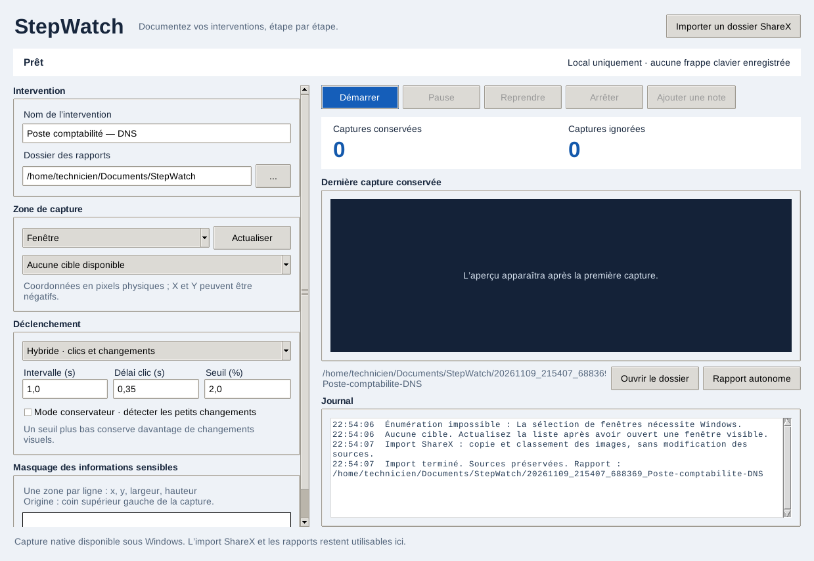
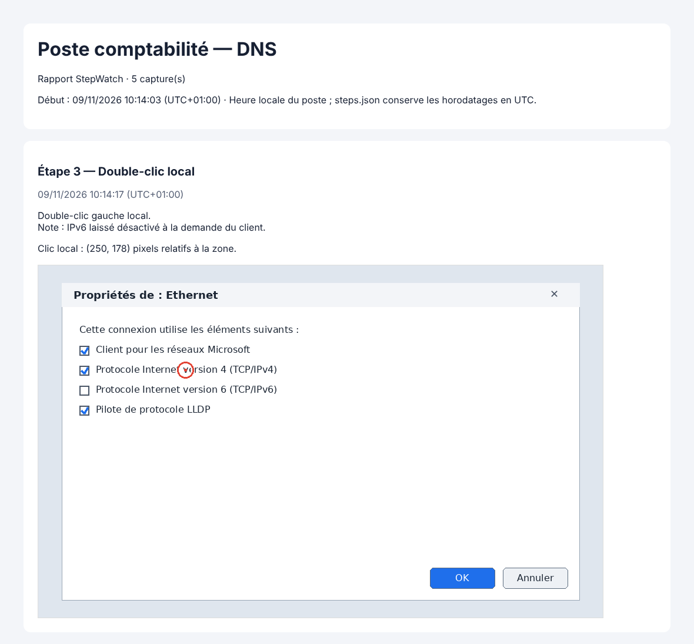

# StepWatch

*[English version](README.en.md)*

StepWatch documente une intervention informatique étape par étape, à partir des pixels visibles sur le poste Windows du technicien. Chaque clic local ou changement visuel devient une capture annotée. Le rapport HTML se consulte hors ligne. Captures et rapports restent sur le poste : aucun agent n'est installé chez le client, et rien n'est envoyé sur Internet.

La version **0.4** utilise Python, Tkinter, Pillow, `mss` et `pynput`. Aucune frappe clavier n'est enregistrée. Les zones sensibles peuvent être masquées avant l'écriture des images. Microsoft a déprécié l'Enregistreur d'actions de Windows (`psr.exe`) : StepWatch en est une alternative locale, pensée pour la télémaintenance.



## Télécharger

Les exécutables sont dans les [Releases](https://github.com/1002-AZ-2001/StepWatch/releases). La [dernière version](https://github.com/1002-AZ-2001/StepWatch/releases/latest) propose :

| Fichier | Pour |
| --- | --- |
| `StepWatch-VERSION-windows-x64.exe` | Windows 10/11 : un seul fichier, sans installation. |
| `StepWatch-VERSION-windows-x64-portable.zip` | Windows : dossier portable, à extraire en entier. |
| `stepwatch_VERSION_amd64.deb` | Debian 12+ et Ubuntu 22.04+ : import ShareX et rapports uniquement. |
| `stepwatch-VERSION-1-x86_64.pkg.tar.zst` | Arch Linux : import ShareX et rapports uniquement. |
| `SHA256SUMS-*.txt` | Vérification des téléchargements. |

Python est inclus. Les exécutables Windows ne sont pas encore signés : SmartScreen peut afficher un avertissement, donc vérifiez d'abord le SHA-256. Les commandes d'installation et de vérification, ainsi que la construction depuis les sources, sont dans le [guide de distribution](docs/distribution.md).

```bash
# Debian ou Ubuntu, après téléchargement du .deb
sudo apt install ./stepwatch_VERSION_amd64.deb
# Arch Linux, après téléchargement du paquet
sudo pacman -U ./stepwatch-VERSION-1-x86_64.pkg.tar.zst
# Lancer, ou vérifier l'installation sans données personnelles
stepwatch
stepwatch --self-test
```

**L'enregistrement nécessite Windows.** Sous Linux, l'interface propose seulement l'import ShareX et les rapports, en session X11 comme en session **Wayland**. Sous Wayland, StepWatch s'affiche par XWayland, présent par défaut sur la plupart des bureaux : voir le [guide de distribution](docs/distribution.md#wayland).

### Depuis les sources, sous Windows

Il faut Windows 10/11 et Python 3.11 ou ultérieur (3.12 recommandé), installé avec Tcl/Tk et pip. Depuis le dossier du dépôt, dans PowerShell :

```powershell
.\scripts\install.ps1
.\scripts\launch.ps1
```

`install.ps1` cherche Python 3.12, 3.13 puis 3.11 avec le lanceur `py`, vérifie Tcl/Tk, puis crée `.venv` avec les versions de `requirements.txt`. Pour forcer un interpréteur : `.\scripts\install.ps1 -Python "C:\Python312\python.exe"`. Aucun script ne modifie la politique d'exécution PowerShell. Si elle bloque les scripts, utilisez directement :

```powershell
py -3.12 -m venv .venv
.\.venv\Scripts\python.exe -m pip install -r requirements.txt
.\.venv\Scripts\python.exe -m stepwatch
```

## Enregistrer une intervention

1. Saisissez un nom et choisissez le dossier des rapports.
2. Sélectionnez une fenêtre, un moniteur ou une zone. **Actualiser** recharge la liste. Les coordonnées sont en pixels physiques ; un écran placé à gauche peut avoir une origine négative.
3. Choisissez un mode : **Hybride** (clics locaux et changements visuels), **Clics uniquement** ou **Changements visuels uniquement**.
4. Réglez le délai après clic, l'intervalle de comparaison et le seuil. Le seuil est une proportion de pixels modifiés : plus il est bas, plus StepWatch garde d'étapes. Le mode conservateur détecte les petits changements.
5. Ajoutez si besoin des masques, un par ligne : `x,y,largeur,hauteur`, relatifs au coin supérieur gauche de la capture. Cliquez sur **Démarrer** ; rien n'est capturé avant.
6. Utilisez **Pause**, **Reprendre** et **Arrêter**. L'aperçu, les compteurs et le journal montrent les captures gardées, les comparaisons ignorées et les erreurs.
7. **Ajouter une note** attache un texte libre à la dernière étape, pendant l'enregistrement ou la pause.
8. Après l'arrêt, **Ouvrir le dossier** affiche la session et **Rapport autonome** produit un fichier HTML unique à joindre à un ticket.

Un double-clic ou un triple-clic donne une seule étape « Double-clic local », capturée après le dernier appui. Pour AnyDesk, TeamViewer ou RDP, sélectionnez la fenêtre locale du logiciel de télémaintenance. Une action du client distant devient un « changement visuel détecté » : StepWatch ne connaît pas la position de son clic, et les marqueurs ne montrent que les clics locaux.

## Captures et rapports



Chaque intervention a son propre dossier :

| Fichier | Contenu |
| --- | --- |
| `captures/*.png` | Captures masquées, avec un marqueur rouge sur les clics locaux. |
| `steps.json` | Étapes, horodatages UTC, déclencheurs, coordonnées des clics, annotations et notes. |
| `rapport.html` | Rapport hors ligne, en heure locale du poste. Il s'imprime en PDF depuis le navigateur sans couper les étapes. |
| `rapport.md` | Même rapport en Markdown, pour un wiki ou un ticket ; mêmes liens vers `captures/`. |
| `rapport-autonome.html` | Créé par **Rapport autonome** : un seul fichier, captures intégrées (environ +33 % de taille). |

**Importer un dossier ShareX** copie les images d'un dossier, sans ses sous-dossiers, dans une nouvelle intervention. Elles sont classées par date de modification, puis par nom. Les sources ne sont jamais modifiées. Les masques ne s'appliquent pas à l'import.

Les captures peuvent contenir des données confidentielles. Choisissez un dossier adapté et gérez sa protection et sa conservation. Un dossier synchronisé (OneDrive, partage sauvegardé dans le cloud…) enverrait les captures hors du poste. Les masques restent fixes par rapport à la capture et ne détectent pas les mots de passe : n'affichez pas de données sensibles hors des zones masquées.

Si un antivirus ou un outil de synchronisation verrouille brièvement un fichier, l'écriture est réessayée. Si le rapport reste verrouillé, le PNG est conservé et l'enregistrement continue ; le rapport est réécrit à la capture suivante et à l'arrêt.

## Limites de la capture Windows

- La capture prend les pixels du bureau visible : gardez la fenêtre cible dégagée, sinon une fenêtre superposée apparaît dans l'image.
- Un clic n'est rattaché à la cible que s'il tombe sur elle ou sur un dialogue qu'elle possède.
- Une fenêtre fermée, réduite ou invisible produit une erreur explicite dans le journal.
- Le bureau sécurisé UAC, les contenus protégés et les fenêtres élevées peuvent empêcher la capture ou la réception des clics.
- Windows peut retirer sans prévenir un hook souris trop lent. StepWatch le détecte par l'état physique des boutons, le réinstalle et le signale (« des clics ont pu manquer ») : vérifiez alors les dernières étapes.
- La comparaison visuelle ignore les petites variations, sans garantie pour toutes les animations. Un changement plus bref que l'intervalle peut passer inaperçu.

## Journal de diagnostic

Le journal local `%LOCALAPPDATA%\StepWatch\logs\stepwatch.log` (`~/.local/state/stepwatch/` sous Linux) tourne sur 4 fichiers de 1 Mo au plus. `crash.log` recueille les plantages natifs. Ces fichiers ne contiennent ni image ni frappe, mais peuvent contenir des noms d'intervention, des titres de fenêtres et des chemins : relisez-les avant de les transmettre.

## Développement et suite

- [Architecture](docs/architecture.md) : modules, threads et garanties.
- [Validation](docs/validation.md) : tests automatisés, CI, liste de vérification sur Windows réel et mesures.
- [Distribution](docs/distribution.md) : construction des exécutables et publication d'une nouvelle version (une Release par version).
- [Feuille de route](docs/FEUILLE_DE_ROUTE.md) : versions 0.5 (rapports prêts à partager), 0.6 (capture plus fiable) et 1.0 (diffusion), et enregistrement sous Linux à étudier.
- [Journal des modifications](CHANGELOG.md) et [historique du projet](docs/HISTORIQUE.md).

```bash
.venv/bin/python -m pip install -r requirements-dev.txt
.venv/bin/ruff check stepwatch tests scripts
DISPLAY=:99 STEPWATCH_GUI_TESTS=1 .venv/bin/python -m unittest discover -s tests -v
```

Les images de ce README proviennent d'une exécution réelle sous Linux, sur des captures synthétiques : l'interface après un import ShareX, et un rapport produit par le code de stockage de StepWatch.

Licence : [GNU AGPL v3](LICENSE).

Références : [Enregistreur d'actions déprécié](https://www.neowin.net/news/microsoft-deprecates-even-more-windows-features-steps-recorder-gets-the-axe/), [hooks souris bas niveau](https://learn.microsoft.com/windows/win32/winmsg/lowlevelmouseproc), [mss](https://python-mss.readthedocs.io/), [pynput](https://pynput.readthedocs.io/), [Pillow](https://pillow.readthedocs.io/).
